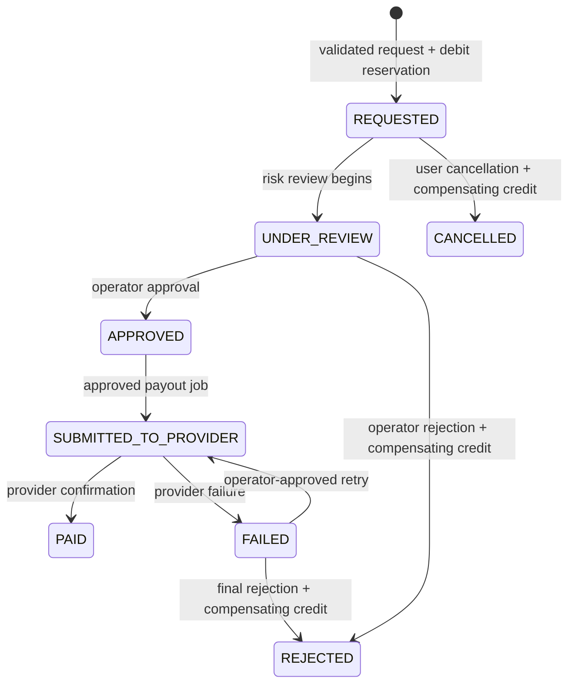

# Roam Rewards Backend Domain Model

## Trust boundary

The mobile client is an untrusted interface. It may request a quest claim, present a simulated advertisement, or request a redemption, but it cannot insert ledger entries, increment a cash-equivalent balance, set a redemption status, or trigger a payout. The backend validates state, creates all reward events, and exposes read-only balances derived from immutable records.

> **Trail Points** are a cash-equivalent balance that may support a future redemption. **Explorer XP** is cosmetic progress only. They must be stored and updated through separate event streams, APIs, access controls, and reporting views.

| Domain aggregate | Authoritative records | Client-visible state | Explicitly excluded |
| --- | --- | --- | --- |
| Cash-equivalent rewards | Verified quest claim, immutable Trail Points ledger entry, conversion-policy version. | Available Trail Points, daily cap usage, receipt history. | Client-calculated balance, ad-based multiplication, direct edits. |
| Cosmetic Explorer XP | Immutable XP event and optional cached wallet projection. | XP balance, level, next-level progress. | Cash conversion, transfer, redemption, or payout impact. |
| Redemption | Request, immutable debit reservation, state-transition history, audit events. | Pending/approved/rejected/paid state and displayed amount. | Immediate client-controlled payment, concealed fees, user-to-user transfers. |
| Fraud and safety | Verification result, location-proof summary, device/session risk signal, operator decision. | Generic accept/reject reason only. | Exact fraud rules, raw device identifiers, precise historical location. |

## Authoritative claim sequence

The client first obtains a short-lived quest session containing a signed server nonce. On submission, the server authenticates the player, validates eligibility, verifies the nonce and quest window, checks the allowed radius and safe-motion signals, enforces a one-claim rule and daily cap, and then inserts both a quest-claim record and a fixed-value Trail Points ledger credit in one database transaction. A unique idempotency key protects against retries and duplicate taps.

Cosmetic ad completion follows a separate path. The production endpoint should accept a server-to-server verified completion from an approved advertising provider, not a client assertion. Its only allowed side effect is one Explorer XP event for a prior verified quest/ad pairing. The database schema does not provide the ad controller a route to Trail Points or redemption tables.

## Redemption state machine

`REQUESTED → UNDER_REVIEW → APPROVED → SUBMITTED_TO_PROVIDER → PAID` is the successful path. `REQUESTED` or `UNDER_REVIEW` may become `REJECTED` or `CANCELLED`; those terminal failures create a compensating Trail Points ledger credit that references the original debit reservation. A failed provider attempt transitions to `FAILED` and requires an operator decision, which either retries through a new provider-attempt record or creates a compensating credit. The service must never alter or delete an existing ledger entry.

## Security requirements

Every financial or quasi-financial write must be authenticated, server-side validated, tenant-scoped, logged with a correlation ID, and protected by an idempotency key. Privileged review endpoints need role-based authorization and step-up authentication. Sensitive identity-verification data should remain tokenized with the verification vendor where possible; store vendor references and high-level verification states, not document images or government-ID values.

The data design assumes a U.S. free-to-play, no-stake reward product. Before live payout, obtain professional review of the game classification, official rules, geographic availability, identity process, tax and reporting obligations, payout-provider contract, privacy retention policy, and advertising integration.
